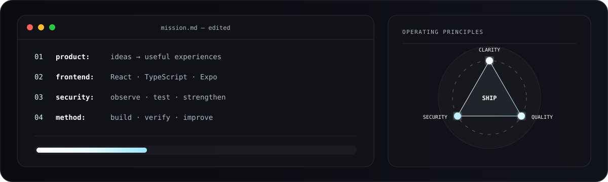
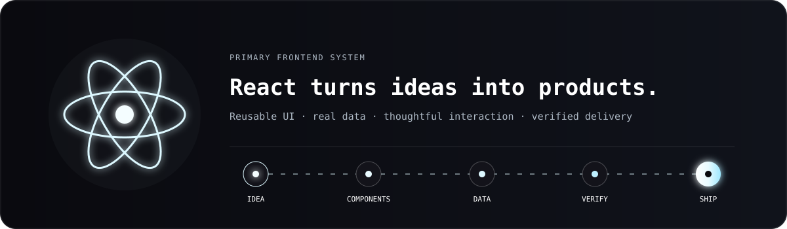
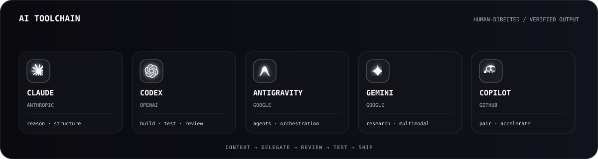

  
    
  
   
  
  
  

---

## <code>$ whoami</code>

  

  

I build digital products where the interface, data, and user experience work as one system. **React is at the center of my work**: I enjoy turning complex ideas into clear, fast, useful experiences for the web and mobile devices.

I also bring a security mindset shaped by hands-on practice with **Kali Linux**, controlled labs, technical analysis, and continuous learning. I do not see cybersecurity as a final layer; I see it as part of designing and building responsible software.

> My goal is not to collect technologies. It is to understand the problem, choose the right tools, and deliver something that actually works.

---

## <code>$ ./react --focus=product</code>

  

  <strong>Frontend and mobile</strong>  
  
    
  <strong>Languages and automation</strong>  
  
    
  <strong>Services and tools</strong>  
  

C · C++ · Java · PHP · Sass: technologies I am exploring. HTML and CSS: web structure and styling. SQL: queries and data modeling.

### What I bring to the table

- **React and TypeScript:** maintainable components, coherent interfaces, and real data flows.
- **Web and mobile:** experiences built with Vite, React Native, and Expo.
- **Applied backend work:** Supabase, PostgreSQL, authentication, real-time data, and deployments.
- **Automation:** Bash, Python, and integrations that reduce repetitive work.
- **Security:** hands-on practice with Kali Linux and an approach centered on risk, diagnosis, and continuous improvement.
- **Networking:** IPv4 subnetting, address planning, and configuring Cisco networks and devices in lab environments.
- **Applied AI:** using Claude, Codex, Antigravity, Gemini, and Copilot according to the problem, always with human review and technical validation.

---

## <code>$ ls ~/projects --featured</code>

| Project | What I am building | Stack / focus |
|---|---|---|
| **Nexxus** | A full-stack ecosystem that turns complex processes into clearer web and mobile experiences. | React · React Native · Expo · TypeScript · Supabase · PostgreSQL · Vercel |
| **SparkApp** | A private product lab where I explore interfaces, workflows, and new ideas. | JavaScript · UX · prototyping |
| [**Axiom-OS**](https://github.com/bryan202675/Axiom-OS) | Visual experiments with frameworks and interface systems. | CSS · frontend design |
| [**Synapse**](https://github.com/bryan202675/Synapse) | Web exploration focused on structure, interaction, and hands-on learning. | HTML · frontend |
| [**PicoClaw Discord**](https://github.com/bryan202675/picoclaw-discord) | Experiments in automation and messaging-channel integrations. | Shell · automation |

Repositories show the visible result; behind each one are decisions, tests, fixed bugs, and a healthy drive to make the next version better.

---

## <code>$ ai-toolchain --mode=agentic</code>

  

  

I do not use AI as a black box or a substitute for judgment. I use it as a **working system**: I provide context, delegate specific tasks, review changes, run tests, and decide what reaches production.

- **Claude:** reasoning, structure, documentation, and analysis of broad context.
- **OpenAI Codex:** implementation, diagnosis, code review, and verification within the repository.
- **Google Antigravity:** exploring agent-first workflows and coordinating tasks across the editor, terminal, and browser.
- **Gemini and GitHub Copilot:** multimodal research, contextual assistance, and faster development cycles.

> Speed matters; traceability, testing, and accountability matter more.

---

## <code>$ security --mindset</code>

  &nbsp;&nbsp;&nbsp;&nbsp;
  &nbsp;&nbsp;&nbsp;&nbsp;
  &nbsp;&nbsp;&nbsp;&nbsp;
  

My cybersecurity experience is grounded in hands-on practice with **Kali Linux** and in understanding how systems behave under pressure. I work in controlled environments with an ethical approach: observe, understand, document, and strengthen.

    security_mode: ethical-and-controlled
    current_focus: linux · analysis · secure development · continuous learning
    rule_zero: understand the system before attempting to improve it

---

## <code>$ credentials --and-learning</code>

<table>
  <tr>
    <td width="88" align="center">
      
    </td>
    <td>
      <strong>Anthropic training and certifications</strong> 
      I have completed Anthropic certifications and apply what I learned to work with Claude in a structured way: better context, clearer instructions, critical review, and verifiable results. I keep this training separate from other AI tools so the credentials remain clear.
    </td>
  </tr>
  <tr>
    <td width="88" align="center">
      
    </td>
    <td>
      <strong>OpenAI Academy · AI development</strong> 
      The API builder pathway includes Scope AI Solutions, Evaluate AI Applications, Design and Build Agentic Systems, Build with Retrieval-Augmented Generation, and Optimize AI Application Performance. <a href="https://academy.openai.com/pages/courses">View official courses</a>.
    </td>
  </tr>
  <tr>
    <td width="88" align="center">
      
    </td>
    <td>
      <strong>Codex · AI-assisted programming</strong> 
      The OpenAI Academy pathway includes Get Started with Codex, Extend Codex Workflows, and Scale Codex Across Governed Teams and Systems. <a href="https://openai.com/academy/codex/">View the official pathway</a>.
    </td>
  </tr>
</table>

OpenAI Academy pathways may award completion certificates; personal credentials will be linked when they are available for verification.

> AI amplifies the process; responsibility for decisions and quality remains human.

---

## <code>$ connect --github</code>

  

