  
    
  
   
  
  
  

---

## <code>$ whoami</code>

  

  

Construyo productos digitales donde la interfaz, los datos y la experiencia trabajan como un solo sistema. **React es mi centro de gravedad**: me interesa convertir ideas complejas en experiencias claras, rápidas y útiles, tanto en web como en móvil.

También desarrollo una mentalidad de seguridad mediante experiencia práctica con **Kali Linux**, laboratorios controlados, análisis técnico y aprendizaje constante. No veo la ciberseguridad como una capa final: la considero parte de cómo se diseña y construye software responsable.

> Mi objetivo no es acumular tecnologías. Es entender el problema, elegir buenas herramientas y entregar algo que realmente funcione.

---

## <code>$ ./react --focus=product</code>

  

  <strong>Frontend y móvil</strong>  
  
    
  <strong>Lenguajes y automatización</strong>  
  
    
  <strong>Servicios y herramientas</strong>  
  

C · C++ · Java · PHP · Sass: tecnologías en exploración. HTML y CSS: estructura y estilo web. SQL: consultas y modelado de datos.

### Lo que aporto

- **React y TypeScript:** componentes mantenibles, interfaces coherentes y flujos de datos reales.
- **Web y móvil:** experiencias construidas con Vite, React Native y Expo.
- **Backend aplicado:** Supabase, PostgreSQL, autenticación, datos en tiempo real y despliegues.
- **Automatización:** Bash, Python e integraciones para reducir trabajo repetitivo.
- **Seguridad:** práctica con Kali Linux y una forma de pensar orientada a riesgos, diagnóstico y mejora continua.
- **Redes:** subneteo IPv4, planificación de direcciones y configuración de redes y equipos Cisco en entornos de práctica.
- **IA aplicada:** orquestación de Claude, Codex, Antigravity, Gemini y Copilot según el problema, siempre con revisión humana y validación técnica.

---

## <code>$ ls ~/projects --featured</code>

| Proyecto | Qué estoy construyendo | Stack / enfoque |
|---|---|---|
| **Nexxus** | Ecosistema full-stack para convertir procesos complejos en experiencias web y móviles más claras. | React · React Native · Expo · TypeScript · Supabase · PostgreSQL · Vercel |
| **SparkApp** | Laboratorio privado de producto donde exploro interfaces, flujos y nuevas ideas. | JavaScript · UX · prototipado |
| [**Axiom-OS**](https://github.com/bryan202675/Axiom-OS) | Pruebas visuales y experimentación con frameworks y sistemas de interfaz. | CSS · diseño frontend |
| [**Synapse**](https://github.com/bryan202675/Synapse) | Exploración web enfocada en estructura, interacción y aprendizaje práctico. | HTML · frontend |
| [**PicoClaw Discord**](https://github.com/bryan202675/picoclaw-discord) | Experimentos de automatización e integración para canales de mensajería. | Shell · automatización |

Los repositorios son el resultado visible; detrás de cada uno hay decisiones, pruebas, errores corregidos y una obsesión saludable por mejorar la siguiente versión.

---

## <code>$ ai-toolchain --mode=agentic</code>

  

  

No uso la IA como una caja negra ni como sustituto del criterio. La incorporo como un **sistema de trabajo**: doy contexto, delego tareas concretas, reviso cambios, ejecuto pruebas y decido qué llega a producción.

- **Claude:** razonamiento, estructura, documentación y análisis de contexto amplio.
- **OpenAI Codex:** implementación, diagnóstico, revisión de código y verificación dentro del repositorio.
- **Google Antigravity:** exploración de flujos agentic-first y orquestación de tareas entre editor, terminal y navegador.
- **Gemini y GitHub Copilot:** investigación multimodal, asistencia contextual y aceleración del ciclo de desarrollo.

> La velocidad importa; la trazabilidad, las pruebas y la responsabilidad importan más.

---

## <code>$ security --mindset</code>

  &nbsp;&nbsp;&nbsp;&nbsp;
  &nbsp;&nbsp;&nbsp;&nbsp;
  &nbsp;&nbsp;&nbsp;&nbsp;
  

Mi experiencia con ciberseguridad se apoya en la práctica con **Kali Linux** y en comprender cómo se comportan los sistemas bajo presión. Trabajo desde entornos controlados y con una perspectiva ética: observar, entender, documentar y fortalecer.

    security_mode: ethical-and-controlled
    current_focus: linux · analysis · secure development · continuous learning
    rule_zero: understand the system before attempting to improve it

---

## <code>$ credentials --and-learning</code>

<table>
  <tr>
    <td width="88" align="center">
      
    </td>
    <td>
      <strong>Formación y certificaciones de Anthropic</strong> 
      He completado certificaciones de Anthropic y aplico ese aprendizaje para trabajar con Claude de forma estructurada: mejor contexto, mejores instrucciones, revisión crítica y resultados verificables. Esta formación se presenta por separado de las demás herramientas de IA para mantener claras las credenciales.
    </td>
  </tr>
  <tr>
    <td width="88" align="center">
      
    </td>
    <td>
      <strong>OpenAI Academy · desarrollo con IA</strong> 
      Ruta de construcción con la API: Scope AI Solutions, Evaluate AI Applications, Design and Build Agentic Systems, Build with Retrieval-Augmented Generation y Optimize AI Application Performance. <a href="https://academy.openai.com/pages/courses">Ver cursos oficiales</a>.
    </td>
  </tr>
  <tr>
    <td width="88" align="center">
      
    </td>
    <td>
      <strong>Codex · programación asistida</strong> 
      Ruta de OpenAI Academy: Get Started with Codex, Extend Codex Workflows y Scale Codex Across Governed Teams and Systems. <a href="https://openai.com/academy/codex/">Ver ruta oficial</a>.
    </td>
  </tr>
</table>

Las rutas de OpenAI Academy pueden otorgar certificados de finalización; los comprobantes personales se enlazarán cuando estén disponibles para verificación.

> La IA amplifica el proceso; la responsabilidad sobre las decisiones y la calidad sigue siendo humana.

---

## <code>$ connect --github</code>

  

