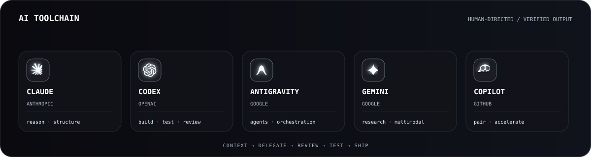

<div align="center">
  <a href="https://github.com/bryan202675">
    
  </a>
  <br><br>
  
  <br>
  <a href="https://github.com/bryan202675"></a>
  
  
</div>

---

## <code>$ whoami</code>

<p align="center">
  
</p>

<p align="center">
  
</p>

I am a **full-stack developer with a deep creative passion for the frontend and a security-first mindset**. While I build end-to-end applications—handling data persistence, authentication, and APIs with Supabase, PostgreSQL, and ASP.NET Core—the frontend is where my creative mindset thrives: designing intuitive interfaces, crafting fluid UI motion, and obsessing over the interactions that make software feel effortless.

I also cultivate a security-first mindset through hands-on practice with **Kali Linux**, network diagnostics, and controlled labs. For me, responsible software brings everything together: an architecture that scales, visual craft that inspires users, and security built into every commit.

> *“My goal is not to collect technologies. It is to understand the problem deeply, choose the right tools, and build something that genuinely works.”*

---

## <code>$ ./stack --detailed</code>

<p align="center">
  
</p>

<div align="center">
  <strong>Frontend & Mobile</strong><br><br>
  
  <br><br>
  <strong>Backend & Data Persistence</strong><br><br>
  
  <br><br>
  <strong>Security, Systems & Automation</strong><br><br>
  
</div>

<br>

### What I bring to the table

- **Frontend & UI Motion:** maintainable React and TypeScript components, fluid animations with Motion, and accessible component architectures (WCAG/A11y).
- **Web and Mobile:** scalable experiences built with Next.js, Vite, and React Native / Expo.
- **Backend Architecture:** Supabase, PostgreSQL, relational data modeling, authentication, real-time data, and REST/MVC APIs.
- **Automation:** Bash, Python, and automated pipelines that reduce repetitive work.
- **Security:** hands-on practice with Kali Linux, network analysis, and continuous security diagnosis.
- **Networking:** IPv4 subnetting, address planning, and configuring Cisco networks in controlled lab environments.
- **Applied AI:** utilizing Claude, OpenAI Codex, Antigravity, and Gemini with human review and strict technical verification.

---

## <code>$ ls ~/projects --featured</code>

<table>
  <tr>
    <td width="50%" valign="top">
      <h3><a href="https://nexxus-hr.vercel.app/">Nexxus HR</a></h3>
      <p><strong>Enterprise HR & Talent Operations SaaS Platform</strong></p>
      <p>A scalable full-stack web application designed to centralize and simplify internal human resources management and operational company workflows.</p>
      <p><strong>Key Highlights:</strong></p>
      <ul>
        <li>Role-based access control (RBAC) with secure relational persistence.</li>
        <li>High-performance dashboard with intuitive employee directory and data management.</li>
      </ul>
      <p><code>Next.js</code> · <code>TypeScript</code> · <code>Supabase</code> · <code>PostgreSQL</code> · <code>Tailwind CSS</code></p>
      <p>
        <a href="https://nexxus-hr.vercel.app/"><strong>🌐 Live Demo</strong></a>
      </p>
    </td>
    <td width="50%" valign="top">
      <h3><a href="https://aperture-media.vercel.app/">Aperture</a></h3>
      <p><strong>Digital Media Showcase & Visual Experience</strong></p>
      <p>A high-performance digital portfolio platform engineered for photography and visual production professionals with an editorial, cinematic standard.</p>
      <p><strong>Key Highlights:</strong></p>
      <ul>
        <li>Advanced media asset optimization ensuring sub-second load times without quality loss.</li>
        <li>Fluid layout transitions and minimalist aesthetic hierarchy.</li>
      </ul>
      <p><code>Next.js</code> · <code>TypeScript</code> · <code>Tailwind CSS</code> · <code>Asset Optimization</code></p>
      <p>
        <a href="https://aperture-media.vercel.app/"><strong>🌐 Live Demo</strong></a>
      </p>
    </td>
  </tr>
  <tr>
    <td width="50%" valign="top">
      <h3><a href="https://github.com/bryan202675/MotionLab">MotionLab</a></h3>
      <p><strong>Accessible UI Motion & Micro-interactions Engine</strong></p>
      <p>An expressive and modular design engineering collection featuring production-ready React motion components, gestures, and fluid interactive feedback.</p>
      <p><strong>Key Highlights:</strong></p>
      <ul>
        <li>Strict adherence to accessibility standards (<code>prefers-reduced-motion</code> & A11y).</li>
        <li>60 FPS GPU-accelerated micro-interactions and modular gesture handlers.</li>
      </ul>
      <p><code>React</code> · <code>TypeScript</code> · <code>Motion</code> · <code>Tailwind CSS</code> · <code>A11y</code></p>
      <p>
        <a href="https://github.com/bryan202675/MotionLab"><strong>📦 Source Code</strong></a>
      </p>
    </td>
    <td width="50%" valign="top">
      <h3><a href="https://gridagency.vercel.app/">Grid Agency</a></h3>
      <p><strong>Interactive Digital Showcase & Brand Experience</strong></p>
      <p>An editorial digital experience developed for an independent design studio, featuring custom interactive portfolios, smooth momentum scrolling, and refined aesthetic hierarchy.</p>
      <p><strong>Key Highlights:</strong></p>
      <ul>
        <li>Fluid page transitions and custom interactive cursor interactions.</li>
        <li>Optimized asset pipelines ensuring sub-second load times and 100/100 performance scores.</li>
      </ul>
      <p><code>Next.js</code> · <code>TypeScript</code> · <code>Smooth Scroll</code> · <code>Design Engineering</code></p>
      <p>
        <a href="https://gridagency.vercel.app/"><strong>🌐 Live Demo</strong></a>
      </p>
    </td>
  </tr>
</table>

---

## <code>$ ai-toolchain --mode=agentic</code>

<p align="center">
  
</p>

<p align="center">
  
</p>

I do not use AI as a black box or a substitute for judgment. I use it as a **working system**: I provide context, delegate specific tasks, review changes, run tests, and decide what reaches production.

- **Claude:** reasoning, structure, documentation, and analysis of broad context.
- **OpenAI Codex:** implementation, diagnosis, code review, and verification within the repository.
- **Google Antigravity:** exploring agent-first workflows and coordinating tasks across the editor, terminal, and browser.
- **Gemini and GitHub Copilot:** multimodal research, contextual assistance, and faster development cycles.

> *Speed matters; traceability, testing, and accountability matter more.*

---

## <code>$ security --mindset</code>

<div align="center">
  &nbsp;&nbsp;&nbsp;&nbsp;
  &nbsp;&nbsp;&nbsp;&nbsp;
  &nbsp;&nbsp;&nbsp;&nbsp;
  
</div>

My cybersecurity experience is grounded in hands-on practice with **Kali Linux** and in understanding how systems behave under pressure. I work in controlled environments with an ethical approach: observe, understand, document, and strengthen.

```yaml
security_mode: ethical-and-controlled
current_focus: linux · analysis · secure development · continuous learning
rule_zero: understand the system before attempting to improve it
```

---

## <code>$ credentials --and-learning</code>

<table>
  <tr>
    <td width="88" align="center">
      
    </td>
    <td>
      <strong>Anthropic training and certifications</strong><br>
      I have completed Anthropic certifications and apply what I learned to work with Claude in a structured way: better context, clearer instructions, critical review, and verifiable results. I keep this training separate from other AI tools so the credentials remain clear.
    </td>
  </tr>
  <tr>
    <td width="88" align="center">
      
    </td>
    <td>
      <strong>OpenAI Academy · AI development</strong><br>
      The API builder pathway includes Scope AI Solutions, Evaluate AI Applications, Design and Build Agentic Systems, Build with Retrieval-Augmented Generation, and Optimize AI Application Performance. <a href="https://academy.openai.com/pages/courses">View official courses</a>.
    </td>
  </tr>
  <tr>
    <td width="88" align="center">
      
    </td>
    <td>
      <strong>Codex · AI-assisted programming</strong><br>
      The OpenAI Academy pathway includes Get Started with Codex, Extend Codex Workflows, and Scale Codex Across Governed Teams and Systems. <a href="https://openai.com/academy/codex/">View the official pathway</a>.
    </td>
  </tr>
</table>

<sub>OpenAI Academy pathways may award completion certificates; personal credentials will be linked when they are available for verification.</sub>

> *AI amplifies the process; responsibility for decisions and quality remains human.*

---

## <code>$ connect --channels</code>

<div align="center">
  <a href="https://github.com/bryan202675">
    
  </a>
  &nbsp;&nbsp;
  <a href="mailto:bryan.hernandez4bm@gmail.com">
    
  </a>
</div>
