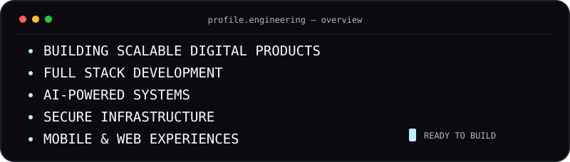
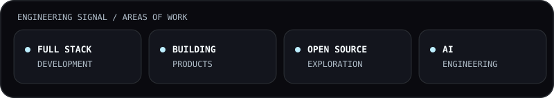
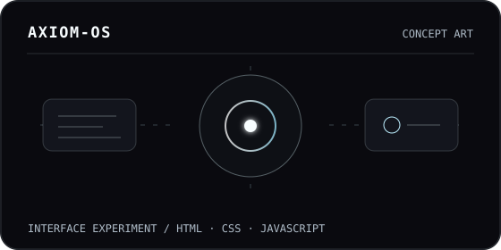
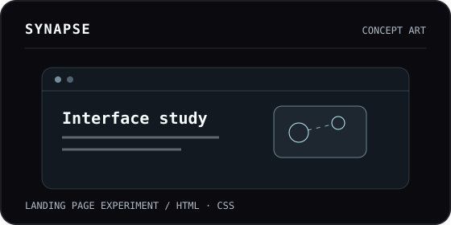
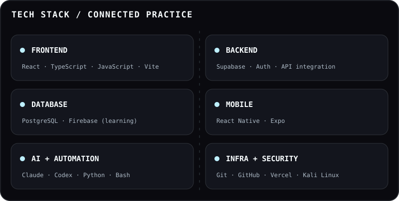
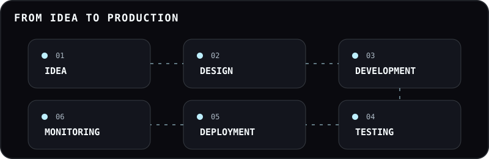
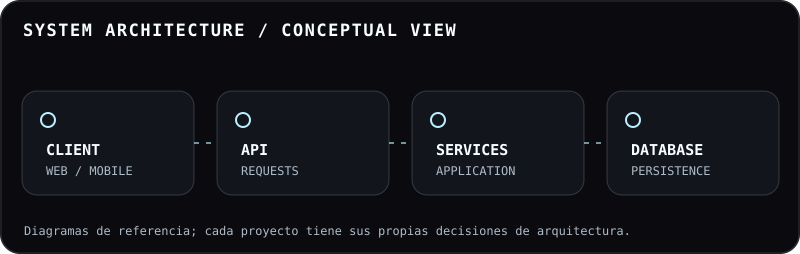
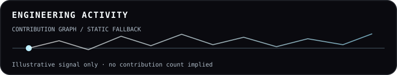
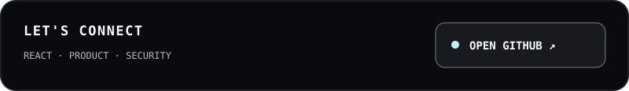
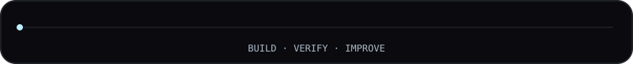

<div align="center">
  <a href="https://github.com/bryan202675">
    
  </a>
  <br><br>
  
  <br>
  
  
  
</div>

---

## <code>$ whoami</code>

<p align="center"><picture><source media="(max-width: 600px)" srcset="assets/profile/intro-terminal-mobile.svg"></picture></p>

<p align="center">
  <picture>
    <source media="(prefers-reduced-motion: reduce)" srcset="assets/profile/matchday-still.jpg">
    
  </picture>
</p>

Construyo productos digitales donde la interfaz, los datos y la experiencia trabajan como un solo sistema. **React es mi centro de gravedad**: convierto problemas complejos en experiencias claras, rápidas y útiles para web y móvil.

También desarrollo una mentalidad de seguridad mediante práctica con **Kali Linux**, laboratorios controlados y análisis técnico. Para mí, la ciberseguridad forma parte del diseño y la construcción responsable de software.

> Mi objetivo no es acumular tecnologías. Es entender el problema, elegir buenas herramientas y entregar algo que realmente funcione.

<p align="center"><picture><source media="(max-width: 600px)" srcset="assets/profile/engineering-signal-mobile.svg"></picture></p>

---

## <code>$ ls ~/projects --featured</code>

Dos experimentos públicos de interfaz. Son **conceptos visuales**, no productos operativos ni sistemas de producción.

<table>
  <tr>
    <td width="50%" valign="top">
      <a href="https://github.com/bryan202675/Axiom-OS"></a><br>
      <strong><a href="https://github.com/bryan202675/Axiom-OS">Axiom-OS ↗</a></strong><br>
      Concepto de interfaz con lenguaje visual de sistema operativo. Explora composición, jerarquía e interacción en una landing page.<br>
      <sub>HTML · CSS · JavaScript · experimento visual · repositorio público</sub>
    </td>
    <td width="50%" valign="top">
      <a href="https://github.com/bryan202675/Synapse"></a><br>
      <strong><a href="https://github.com/bryan202675/Synapse">Synapse ↗</a></strong><br>
      Landing page conceptual enfocada en identidad, estructura y comunicación visual de un producto digital.<br>
      <sub>HTML · CSS · experimento visual · repositorio público</sub>
    </td>
  </tr>
</table>

En trabajo privado, **Nexxus** es mi proyecto full-stack de producto web y móvil con React, React Native, Expo, TypeScript, Supabase y PostgreSQL. **SparkApp** es un laboratorio de interfaces y prototipos; también exploro automatización para canales de mensajería con **PicoClaw Discord**. No enlazo repositorios privados o no verificados.

---

## <code>$ stack --focus=react</code>

<p align="center"></p>

<p align="center"><picture><source media="(max-width: 600px)" srcset="assets/profile/tech-network-mobile.svg"></picture></p>

**Uso habitual:** React, TypeScript, JavaScript, HTML, CSS, Vite, React Native, Expo, Python, Bash, Supabase, PostgreSQL, Git y Linux. **En exploración:** Next.js, Firebase, C, C++, C#, Java, PHP y Sass; distingo aprendizaje de experiencia aplicada.

- **Interfaz y producto:** componentes mantenibles, flujos coherentes y atención a los estados reales de uso.
- **Web y móvil:** construcción con React y Expo, desde el prototipo hasta la integración con datos.
- **Backend aplicado:** autenticación, consultas, tiempo real y despliegue con Supabase/PostgreSQL.
- **Automatización y seguridad:** scripts para reducir trabajo repetitivo y práctica ética con Kali Linux.

---

## <code>$ ./build --from-idea-to-production</code>

<p align="center"><picture><source media="(max-width: 600px)" srcset="assets/profile/delivery-flow-mobile.svg"></picture></p>

Primero aclaro el problema; después diseño el flujo, implemento, pruebo y reviso lo que realmente se entrega. La velocidad solo cuenta cuando el resultado es comprensible, verificable y mantenible.

---

## <code>$ ai-toolchain --human-in-control</code>

<p align="center"></p>

Incorporo la IA como herramienta de trabajo, no como sustituto del criterio: doy contexto, delimito tareas, reviso cambios, ejecuto pruebas y decido qué se publica.

- **Claude:** razonamiento, estructura, documentación y análisis de contexto.
- **OpenAI Codex:** implementación, diagnóstico, revisión de código y verificación en el repositorio.
- **Google Antigravity:** exploración de flujos de agentes entre editor, terminal y navegador.
- **Gemini y GitHub Copilot:** asistencia contextual e investigación según la tarea.

> Contexto → delegación → revisión → pruebas → entrega. La responsabilidad final sigue siendo humana.

---

## <code>$ architecture --think-in-systems</code>

<p align="center"><picture><source media="(max-width: 600px)" srcset="assets/profile/architecture-mobile.svg"></picture></p>

Este diagrama expresa cómo pienso las responsabilidades entre capas; **no representa la arquitectura exacta de todos mis proyectos**. Me interesa que la interfaz, las reglas de negocio y los datos tengan contratos claros.

---

## <code>$ security --mindset</code>

Mi práctica con **Kali Linux** se desarrolla en entornos controlados y con una perspectiva ética: observar, entender, documentar y fortalecer. No presento esa práctica como una certificación ni como experiencia profesional no demostrada.

```text
security_mode  = ethical-and-controlled
current_focus  = linux · analysis · secure development
rule_zero      = understand the system before improving it
```

---

## <code>$ credentials --provider=anthropic</code>

<table>
  <tr>
    <td width="88" align="center"></td>
    <td><strong>Formación y certificaciones de Anthropic</strong><br>He completado certificaciones de Anthropic y aplico ese aprendizaje para trabajar con Claude de forma estructurada: mejor contexto, instrucciones claras, revisión crítica y resultados verificables.</td>
  </tr>
</table>

La formación en Claude aparece separada del resto de herramientas de IA para no confundir uso de herramientas con credenciales.

---

## <code>$ github --activity</code>

<p align="center"><picture><source media="(max-width: 600px)" srcset="assets/profile/activity-fallback-mobile.svg"></picture></p>

La actividad real está en mi [perfil de GitHub](https://github.com/bryan202675?tab=overview). El [workflow de contribuciones](.github/workflows/contribution-snake.yml) generará una serpiente con versiones clara y oscura en la rama `output` cuando se ejecute. El panel actual es ilustrativo y no representa estadísticas reales.

---

## <code>$ connect --github</code>

Si te interesa construir una interfaz útil, conversar sobre React o compartir ideas de seguridad responsable, conversemos en GitHub.

<p align="center"><a href="https://github.com/bryan202675"><picture><source media="(max-width: 600px)" srcset="assets/profile/connect-github-mobile.svg"></picture></a></p>

<p align="center"><a href="https://github.com/bryan202675"><picture><source media="(max-width: 600px)" srcset="assets/profile/footer-pulse-mobile.svg"></picture></a></p>

<p align="center"><sub>Construyendo con curiosidad, criterio y constancia desde El Salvador.</sub></p>
